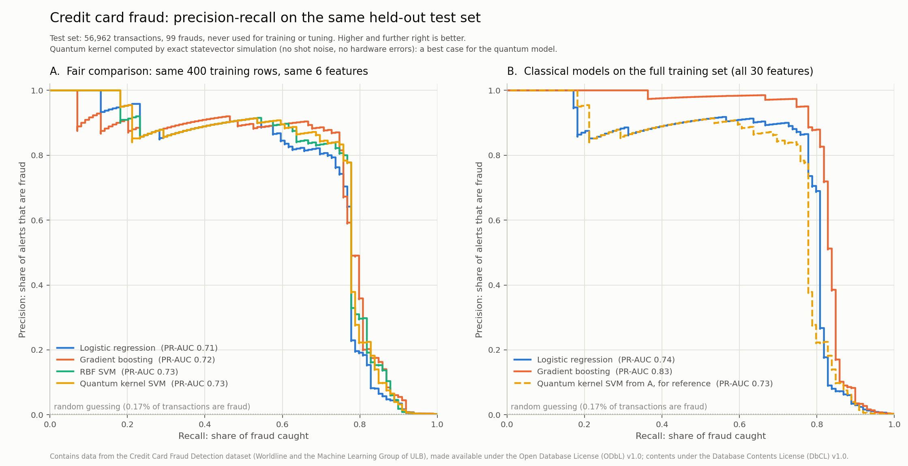

# Fraud detection: classical models vs a quantum kernel

Generated by `run_all.py` v1.0.0 on 2026-11-08 12:15. Every number below comes from that run.

## Bottom line

* Best model overall: Gradient boosting (full), PR-AUC 0.826, catching 83% of fraud at 0.1% false-positive rate.
* Lowest total cost: Gradient boosting (full), 7,420 on the test set (review nothing: 29,700).
* Fair comparison, primary subsample: RBF SVM and Quantum kernel SVM tie for first at PR-AUC 0.727; all 4 sit within 0.019 of each other, inside the +/-0.052 bootstrap noise shown below. The quantum kernel SVM ranks 1 of 4, at 0.727.
* The quantum kernel is not detectably different from Gradient boosting (both on the subsample): the PR-AUC difference +0.003 has a 95% interval of -0.049 to +0.055, which includes zero.
* Across 5 subsample draws (overlapping: any two share about 67% of their frauds), RBF SVM has the best mean PR-AUC (0.717); the quantum kernel SVM ranks 3 of 4 (0.702, range 0.667 to 0.727). The widest swing from draw to draw belongs to Gradient boosting.

This is a simulation of a quantum computer with no noise at all, which is the most favourable setting a quantum model can get. Real hardware would add measurement noise (see the shot-noise table) and gate errors (not modelled).

## Results on the held-out test set

Test set: 56,962 transactions, 99 of them fraud (0.17%). No model saw these rows during training or tuning. Costs use 300 per missed fraud and 20 per analyst review (illustrative figures; change them with `--miss-cost` and `--review-cost`). Each model's alert threshold was set on the validation set to minimise cost, then applied unchanged here.

| Model | Training data | PR-AUC | Recall at 0.1% FPR | Alerts | Frauds caught | False alarms | Test cost | Accuracy (not used to rank) |
|---|---|---|---|---|---|---|---|---|
| Logistic regression | full: 170,884 rows, 30 features | 0.744 | 80.8% | 124 | 80 of 99 | 44 | 8,180 | 99.889% |
| Gradient boosting | full: 170,884 rows, 30 features | 0.826 | 82.8% | 101 | 81 of 99 | 20 | 7,420 | 99.933% |
| Logistic regression | subsample: 400 rows, 6 features | 0.708 | 77.8% | 108 | 76 of 99 | 32 | 9,060 | 99.903% |
| Gradient boosting | subsample: 400 rows, 6 features | 0.724 | 77.8% | 91 | 74 of 99 | 17 | 9,320 | 99.926% |
| RBF SVM | subsample: 400 rows, 6 features | 0.727 | 77.8% | 107 | 77 of 99 | 30 | 8,740 | 99.909% |
| Quantum kernel SVM | subsample: 400 rows, 6 features | 0.727 | 77.8% | 104 | 77 of 99 | 27 | 8,680 | 99.914% |

| Baseline | Test cost |
|---|---|
| Review nothing | 29,700 |
| Review everything | 1,139,240 |

Accuracy is shown last on purpose. Approving every transaction would score 99.83% accuracy while catching no fraud at all, so a high accuracy says almost nothing here. PR-AUC (area under the precision-recall curve) and recall at a 0.1% false-positive rate measure what an investigations team actually cares about: how much fraud is caught for a given volume of alerts.

## Is the difference real?

With only about 100 frauds in the test set, small PR-AUC gaps can be luck. A paired bootstrap (the test set resampled 1,000 times, the same rows for both models) gives a 95% interval for each difference. The classical comparator in the first row is the subsample model with the best VALIDATION score, so the test set did not choose it.

| Comparison (test PR-AUC) | Difference | 95% bootstrap interval | Reading |
|---|---|---|---|
| Quantum kernel SVM vs Gradient boosting (both on the subsample) | +0.003 | -0.049 to +0.055 | not distinguishable from zero |
| Gradient boosting on full data vs quantum kernel SVM | +0.099 | +0.047 to +0.157 | real difference |
| Gradient boosting on full data vs Gradient boosting on the subsample (more rows AND all 30 features, not separable here) | +0.102 | +0.047 to +0.166 | real difference |

The fair comparison was repeated on 5 subsample draws, each tuned afresh. The draws are NOT independent: the training split holds only 295 frauds and each draw takes 200, so any two share about 67% of their frauds, and all use the same validation and test sets. The spread below therefore understates how much results would move on genuinely new data:

| Model (fair comparison) | Mean PR-AUC | Lowest | Highest |
|---|---|---|---|
| Logistic regression | 0.704 | 0.684 | 0.721 |
| Gradient boosting | 0.675 | 0.632 | 0.724 |
| RBF SVM | 0.717 | 0.712 | 0.727 |
| Quantum kernel SVM | 0.702 | 0.667 | 0.727 |

## Does the winner change with the cost ratio?

The review cost is held fixed and the cost of a missed fraud is varied. Each model's threshold is re-chosen on validation for every ratio.

| Missed fraud costs N x a review | Cheapest model | Test cost |
|---|---|---|
| 5 | Gradient boosting (full) | 3,820 |
| 15 | Gradient boosting (full) | 7,420 |
| 50 | Gradient boosting (full) | 19,580 |
| 150 | Gradient boosting (full) | 51,180 |

The same model, Gradient boosting (full), is cheapest at every ratio from 5 to 150: the ranking here does not hinge on the cost assumption.

## Why the quantum kernel did what it did

* **It had to work with less.** Quantum kernels need one circuit per pair of transactions, so the model trained on 400 rows reduced to 6 features (one per qubit). With all 170,884 training rows and 30 features, gradient boosting reaches PR-AUC 0.826; the best model on the small subsample reaches 0.727.
* **Its best setting was its most classical one.** Validation tuning chose bandwidth 0.002 with 1 repetition(s). There the average overlap between two different transactions is 0.998 (1 = identical), with entries differing by only about 0.0048. In that regime the quantum kernel behaves like a smooth classical kernel (Shaydulin & Wild, 2022), so it competes with the RBF SVM rather than doing something new: it scored 0.727, level with the RBF SVM's 0.727.
* **Both kernels wanted to be as simple as possible.** Validation pushed the quantum kernel and the RBF SVM toward the smooth end of their grids (smallest bandwidth or gamma, weakest regularisation), and both were still improving at the edge. That is the direction in which each kernel becomes SIMPLER: an RBF SVM approaches a linear SVM as gamma shrinks and C grows (Keerthi & Lin, 2003), and a quantum kernel at small bandwidth depends, to leading order, only on squared differences between features (Shaydulin & Wild, 2022). This run did not search further, so it does not show where the limit lies; it does show the data rewarding simpler decision boundaries on these 6 features, which leaves little room for a richer quantum feature space to help.
* **Shot noise makes it worse.** Each kernel entry on a real device is an estimate from repeated measurements (shots). The useful differences between entries are tiny, so they compete with shot noise. Each level below was run 3 times with fresh noise, re-tuning C on a noisy validation kernel each time; the bandwidth stays at its noiseless choice, so a model tuned entirely on noisy hardware could do somewhat better. Gate errors and drift, which real devices add on top, are not modelled:

| Shots per kernel entry | Typical shot error per entry | Test PR-AUC, mean of 3 noise draws | Range |
|---|---|---|---|
| exact (simulator) | 0 | 0.727 | |
| 1,024 | 0.0015 | 0.469 | 0.445 to 0.491 |
| 16,384 | 0.0004 | 0.664 | 0.654 to 0.673 |
| 262,144 | 0.0001 | 0.710 | 0.691 to 0.723 |

Training needs 79,800 circuits and scoring this test set needs 5,354,428 more (one per support vector per transaction). At 1,024 shots each that is 5,564,649,472 circuit executions for one evaluation, and every new transaction in production would need its own one-circuit-per-support-vector scoring step.
* The quantum kernel code was checked against qiskit's own circuit simulation, and 20 overlaps were measured the hardware way (4,096 shots each) on the Aer simulator and matched. The result reflects the method, not a bug.

## What this means for fraud and AML monitoring

* **A fraud model is an alert queue.** Raising the threshold means fewer alerts and more missed fraud; lowering it means more analyst hours. Recall at a fixed false-positive rate asks the operational question directly: with the alert volume the team can handle, how much fraud is caught? The cost table makes the same trade in money. The right threshold, and potentially the right model, depends on what a missed fraud really costs the organisation, so that figure deserves as much scrutiny as the model.
* **For auditors and model risk reviewers**, this project shows the evidence to ask for before accepting any detection model, quantum or not: the same data for every model, equal tuning budgets for the models compared head to head, a test set held back until the end, thresholds set before the test, uncertainty on every comparison, and a run log that reproduces the numbers. Bank model risk guidance, such as the PRA's SS1/23 (UK) and the Federal Reserve's SR 11-7 (US), expects independent validation, benchmarking against alternative models and documentation; evidence of this kind is how a firm would meet it. A quantum model would be a challenger model and should clear the same bar.
* **Card fraud is the easier problem.** Each transaction here is judged on its own and labels arrive quickly (cardholders dispute charges). Money laundering is spread across accounts and time (placement, layering, integration), so AML monitoring looks at networks of payments, and confirmed labels are scarce and slow. IBM's synthetic AMLworld data models that, but at 41.6 GB it is beyond a laptop project; the same comparison method applies.

## What the FCA is testing

On 5 November 2026 the UK Financial Conduct Authority announced a Quantum Experimentation Group, which it describes as the first regulator-led group of its kind. Its first use case is financial crime: participants will try quantum machine learning for anti-money laundering and fraud detection on a common FCA synthetic dataset and compare it with classical techniques. The group launches in Q1 2027; firms, quantum providers and research labs can register interest until 31 December 2026. The FCA notes that taking part is not an endorsement of any technology ([FCA press release](https://www.fca.org.uk/news/press-releases/fca-explore-quantum-computing-tackle-financial-crime)).

This project is a small, public version of the same experiment. It does not predict what the FCA's group will find: their data, hardware access and models will differ. It does show the questions that decide the answer: is the classical baseline as strong as it can be, is the comparison on equal data, and does the result survive real hardware noise and production volumes?

## Limitations

* Some tuned values sit at the end of their grid (listed below). For the two kernels this is the simplifying direction explained above; for all of them a wider grid could shift results.
  * Logistic regression (full): C = 0.0001 is the smallest value tried
  * Logistic regression (subsample): C = 100 is the largest value tried
  * RBF SVM (subsample): gamma = 0.0001 is the smallest value tried
  * RBF SVM (subsample): C = 1000 is the largest value tried
  * Quantum kernel SVM (subsample): bandwidth = 0.002 is the smallest value tried
  * Quantum kernel SVM (subsample): C = 1000 is the largest value tried
* One public card-fraud dataset: two days of European transactions from 2013, with features already anonymised by PCA. Results may not transfer to other portfolios.
* Random split, not by time. Live systems score future transactions with models trained on past ones, which is harder.
* Time (seconds since the first transaction) is a feature, and frauds cluster in time, so under a random split a model can partly learn WHEN fraud happened. Refitting gradient boosting on full data without Time gives PR-AUC 0.822, against 0.826 with it.
* About 100 test frauds, so small differences are within noise (see the intervals). The ranks and the cheapest-model choices carry no interval of their own; read gaps smaller than the bootstrap intervals as ties.
* The quantum kernel ran on a noiseless simulator. The shot-noise test adds measurement noise only; real devices also have gate errors and drift.
* One quantum feature map (qiskit's ZZ map) at one qubit count. Other encodings or trainable kernels could do better or worse; a fair test would give them the same budget the classical models got.
* Costs are illustrative, not sourced. Replace them with your organisation's figures.

## Data

Contains data from the Credit Card Fraud Detection dataset (Worldline and the Machine Learning Group of ULB), made available under the Open Database License (ODbL) v1.0; contents under the Database Contents License (DbCL) v1.0. Citation: Dal Pozzolo, Caelen, Johnson and Bontempi, 'Calibrating Probability with Undersampling for Unbalanced Classification', IEEE SSCI 2015. The raw file is not stored in this repository; `download_data.py` fetches it and checks its published MD5. The mean fraudulent transaction in the data is 122.21 euros.
