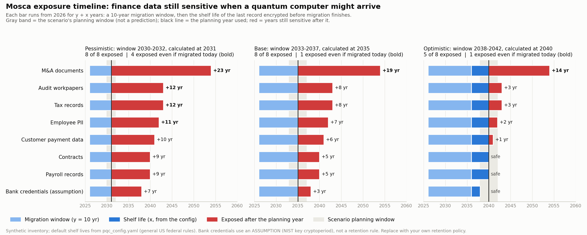

# Post-Quantum Cryptography Readiness Assessment

> **Illustrative assessment of a fictional organization ("SampleCo Finance").** The data
> inventory, codebase and vendors are synthetic, written for a public portfolio project.
> No real company, system, vendor or record was examined.

> **Default retention periods reflect general federal rules. Replace with your organization's records retention policy before relying on results.**

## Scope and status of this document

This is a readiness assessment produced by an open framework. It is **not an audit, an
attestation or a certification, and it expresses no assurance** on any control. Findings
use the Condition / Criteria / Cause / Effect / Recommendation format for readability.

| | |
|---|---|
| **Assessed** | (1) 8 finance data types against Mosca's inequality; (2) code and configuration text in `sample_codebase/` (9 files) for cryptographic algorithm names; (3) sample_vendor_tracker.csv: vendor questionnaire answers as recorded; (4) key exchange sizes and timings on one workstation; (5) one TLS handshake to each public endpoint in `tls_hosts.yaml` (Appendix E, a demo; none is the organization's) and to any vendor endpoints supplied (Finding 6) |
| **Not assessed** | The organization's own network endpoints, vendor endpoints not supplied for the TLS check, production systems, compiled software, databases, cloud-service settings, hardware security modules, key-management procedures, vendor controls beyond their recorded answers, and whether any control operates effectively |
| **Default inputs** | From `pqc_config.yaml`: 8 of 8 shelf lives use default rules or assumptions (not organization policy); migration time 10 years [NCSC-TIMELINE], [NIST-IR-8547] (draft); quantum-arrival planning windows Pessimistic (2030-2032), Base (2033-2037), Optimistic (2038-2042) |
| Assessment as of | 2026 |
| Generated | 2026-10-17T06:54:09 by `run_all.py` in this folder (all figures reproducible) |

## Executive summary

A cryptographically relevant quantum computer (CRQC) could break the RSA and
elliptic-curve cryptography widely used to protect data in transit today. US
agencies warn that data recorded now could be decrypted later [CISA-HNDL], so the
risk is relevant today for any record that must stay confidential beyond a CRQC's
possible arrival. No one knows when that will be; the analysis uses three planning
windows instead.

* **Exposure.** In the Base (2033-2037) planning scenario, **8 of
  8 data types** fail Mosca's inequality with a 10-year
  migration. M&A documents would be exposed even with an instant migration.
* **Code and configuration.** The scanner reported **11 classically weak**,
  **21 quantum-vulnerable** and **9 PQC-ready** usages. These are
  text matches on a synthetic sample,
  not confirmed deployments.
* **Vendors.** The recorded answers of 5 vendors produce **2 High**
  ratings under the stated rule (Finding 5); answers are claims until evidenced.
* **Vendor claims vs handshakes.** No vendor endpoint was checked in this run, so recorded hybrid claims remain uncorroborated (Finding 6).
* **Cost of the fix.** On one workstation, hybrid key exchange took 2,336 bytes and
  about 1.6 ms per handshake (Appendix C), which suggests computation and bandwidth
  are unlikely to be the main barriers.

| # | Finding | Rating |
|---|---|---|
| 1 | Long-lived financial records may be exposed to harvest-now, decrypt-later attacks | High |
| 2 | Classically weak cryptography appears in code and configuration | High |
| 3 | Quantum-vulnerable algorithms are hardcoded across applications | Medium |
| 4 | No maintained cryptographic inventory or migration plan | Medium |
| 5 | Vendor post-quantum readiness is not yet evidenced | High |
| 6 | Vendor hybrid key exchange claims, checked against observed handshakes | Not assessed |

Ratings are illustrative priorities: **High** = known weakness or exposure that migration
speed alone cannot remove, address within 90 days; **Medium** = exposure that grows with
delay, plan within 6 months; **Low** = improvement; **Not assessed** = no evidence in this
run to rate.

## Finding 1: Long-lived financial records may be exposed to harvest-now, decrypt-later attacks

**Rating: High**

**Condition.** Each data type was given a confidentiality shelf life from the inputs in
`pqc_config.yaml` and tested against Mosca's inequality (shelf life + migration time >
years until a CRQC) in three planning scenarios, with a 10-year migration. The scenario
windows are planning ranges, not predictions; each is calculated at the stated year.

| Data type | Shelf life (yrs) | Basis | Pessimistic (2030-2032), at 2031 | Base (2033-2037), at 2035 | Optimistic (2038-2042), at 2040 |
|---|---|---|---|---|---|
| M&A documents | 18 | regulation [IRC-197], [IRS-RECORDS] | **Exposed now** (+23) | **Exposed now** (+19) | **Exposed now** (+14) |
| Audit workpapers | 7 | regulation [SEC-2-06], [PCAOB-1215] | **Exposed now** (+12) | Exposed (+8) | Exposed (+3) |
| Tax records | 7 | regulation [IRS-RECORDS], [IRC-6501] | **Exposed now** (+12) | Exposed (+8) | Exposed (+3) |
| Employee PII | 6 | regulation [ERISA-107], [OSHA-1910-1020] | **Exposed now** (+11) | Exposed (+7) | Exposed (+2) |
| Customer payment data | 5 | regulation [BSA-1010-430], [PCI-FAQ-RETENTION] | Exposed (+10) | Exposed (+6) | Exposed (+1) |
| Contracts | 4 | regulation [UCC-2-725] | Exposed (+9) | Exposed (+5) | safe |
| Payroll records | 4 | regulation [IRS-EMPTAX], [FLSA-516], [FLSA-516-6] | Exposed (+9) | Exposed (+5) | safe |
| Bank credentials (ASSUMPTION) | 2 | assumption [NIST-800-57], [NIST-800-63B] | Exposed (+7) | Exposed (+3) | safe |

"+N" is the number of years a record would remain sensitive after a CRQC could decrypt
it. "Exposed now" means the shelf life alone exceeds the time to the planning year: even
a migration completed today would not protect records already sent or stored under RSA
or elliptic-curve cryptography. Rows marked ASSUMPTION have no retention rule behind them.

**Criteria.** Mosca's inequality [MOSCA-2015]. US agency guidance describes
harvest-now, decrypt-later collection as a current concern [CISA-HNDL], [EO-14412].
NIST's draft transition timeline, NIST IR 8547 (draft), would deprecate 112-bit RSA and
ECC after 2030 and disallow them after 2035 [NIST-IR-8547] (draft). Retention rules [BSA-1010-430], [ERISA-107], [FLSA-516], [FLSA-516-6], [IRC-197], [IRC-6501], [IRS-EMPTAX], [IRS-RECORDS], [OSHA-1910-1020], [PCAOB-1215], [PCI-FAQ-RETENTION], [SEC-2-06], [UCC-2-725] set a minimum period each record must be kept, and therefore protected.

**Cause.** Likely cause, to be confirmed with the data owners: retention periods are set
by law and records management, while encryption choices are made by IT without reference
to how long the data must stay secret, and data is not classified by confidentiality
lifetime.

**Effect.** Records transmitted or stored under RSA or elliptic-curve key exchange today
could become readable within their retention period, which could disclose deal terms,
employee PII, tax and audit evidence, or customer payment data. Because recording
traffic leaves no trace, the organization might not learn of it until the data is used.

**Recommendation.**
1. Replace the default shelf lives with the organization's records retention schedule,
   and add a confidentiality-lifetime attribute to the data classification policy.
2. Prioritize the systems that carry the types exposed even with an instant migration (M&A documents) for hybrid key exchange
   (X25519MLKEM768, [RFC-10024]).
3. Re-run this analysis at least annually, and when threat estimates move [GRI-2025].

**Management response.** *[To be completed by the process owner: action, owner, target date.]*

## Finding 2: Classically weak cryptography appears in code and configuration

**Rating: High**

**Condition.** The scanner reported 11 usages of algorithms or protocols
with known practical weaknesses in 6 files: CW-CIPHER (1), CW-KEYSIZE (1), CW-MD5 (1), CW-SHA1 (3), CW-TLS-LEGACY (5). They include TLS 1.0/1.1 on a customer portal and a settlement client, SHA-1 and MD5 digests, 3DES, and a 1024-bit RSA key on a vendor file transfer.
Each is a text match to be confirmed by the system owner (Appendix B).

**Criteria.** TLS 1.0 and 1.1 are formally deprecated [RFC-8996]. NIST's draft
SP 800-131A Rev. 3 (draft) treats 3DES as disallowed and retires SHA-1 after 2030
[NIST-800-131A] (draft), [NIST-SHA1]. PCI DSS Requirement 12.3.3 calls for an inventory
of cipher suites and protocols reviewed at least every 12 months (text as reproduced in
the PCI SSC's official SAQ D) [PCI-12-3-3].

**Cause.** Likely cause, to be confirmed: legacy partner integrations pinned old protocol
versions, and no control flags deprecated algorithms before deployment.

**Effect.** Known attacks on these algorithms and protocols do not need a quantum
computer. A migration to post-quantum cryptography built on top of them would inherit
their weaknesses.

**Recommendation.**
1. Confirm each Appendix B item with its owner, then plan removal of confirmed weak
   usages, prioritizing anything on an internet-facing path.
2. Add a check (this scanner or an equivalent, after validating it on the organization's
   own files) to the build pipeline so new weak usages are flagged before release.

**Management response.** *[To be completed by the process owner.]*

## Finding 3: Quantum-vulnerable algorithms are hardcoded across applications

**Rating: Medium**

**Condition.** The scanner reported 21 quantum-vulnerable usages in
5 files: QV-DH (3), QV-DSA (2), QV-ECC (8), QV-KEYSIZE (2), QV-RSA (6). Algorithm names and key sizes
appear directly in code and configuration (for example, `key_size=2048`, `getInstance("DSA")`, `RS256`), rather
than being selected from a central policy.

**Criteria.** NIST IR 8547 (draft) proposes deprecating these algorithms after 2030 and
disallowing them after 2035 [NIST-IR-8547] (draft). For high-value and high-impact US
federal systems, EO 14412 sets 31 December 2030 for PQC key establishment
[EO-14412], and the UK NCSC sets 2031 for priority migration
[NCSC-TIMELINE]. These bind their own audiences, not a private finance function,
but they indicate the pace regulators expect. The replacement algorithms are standardized
[FIPS-203], [FIPS-204-205], and hybrid TLS key exchange is published
[RFC-10024].

**Cause.** Likely cause, to be confirmed: cryptography was treated as a fixed
implementation detail, so an algorithm change means editing every location.

**Effect.** Each hardcoded location lengthens the migration time *y*, which directly
worsens Finding 1. A larger RSA key is not a substitute: in the textbook circuit the
qubit count grows as 2n + 3 [BEAUREGARD-2003], so RSA-4096 roughly doubles what an
attack needs, which raises the bar without removing the threat.

**Recommendation.**
1. Centralize algorithm selection in configuration or a shared library.
2. Migrate key exchange first, since it is what harvest-now, decrypt-later targets, using
   the hybrid. Measured on one workstation: 2,336 bytes and about 1.6 ms per
   handshake (Appendix C).
3. Plan signatures (RSA, ECDSA, DSA) to move to ML-DSA on the NIST schedule.

**Management response.** *[To be completed by the process owner.]*

## Finding 4: No maintained cryptographic inventory or migration plan

**Rating: Medium**

**Condition.** No inventory of cryptographic algorithms, protocols and keys existed before
this assessment (a scenario assumption for the fictional organization). The inventory
produced here covers 9 files of code and configuration only. It does
not cover vendor products, SaaS systems, cloud-service defaults, hardware security modules
or live network endpoints.

**Criteria.** PCI DSS Requirement 12.3.3 calls for an up-to-date inventory of cipher
suites and protocols, reviewed at least every 12 months, with a documented strategy for
responding to changes in cryptographic vulnerabilities [PCI-12-3-3]. The G7 Cyber
Expert Group encourages financial institutions to plan for quantum risk
[G7-CEG-2024], and the UK NCSC sets 2028 for completing discovery
[NCSC-TIMELINE].

**Cause.** Likely cause, to be confirmed: ownership of cryptography is spread across
application, infrastructure and vendor-management teams, with no single owner.

**Effect.** Without an inventory, the migration cannot be sized, prioritized by data
lifetime (Finding 1) or evidenced to examiners and auditors.

**Recommendation.**
1. Assign an owner for the cryptographic inventory.
2. Extend the code inventory with network scanning of TLS endpoints and with the vendor
   review in Finding 5.
3. Review the inventory at least annually, alongside the Finding 1 analysis.

**Management response.** *[To be completed by the process owner.]*

## Finding 5: Vendor post-quantum readiness is not yet evidenced

**Rating: High**

**Condition.** 5 vendors that handle the organization's data were sent the
vendor PQC questionnaire (`vendor_pqc_questionnaire.md`); answers are recorded in
`sample_vendor_tracker.csv`. Ratings are computed from the recorded answers by a stated rule
(`vendor_review.py`): a vendor is rated on the exposure ITS stated timeline would add,
using the Mosca inputs across all three planning scenarios. Result: 2 High,
2 Medium, 1 Low. The tracker records the vendors' own
statements; it holds no evidence, so every answer is a claim until evidenced.

| Vendor | Data handled | Responded | Rating | Basis of rating | Follow-up |
|---|---|---|---|---|---|
| Vendor A (fictional payroll SaaS) | Payroll records, Employee PII | yes | **Medium** | PQC by 2028 leaves Payroll records exposed only in the Pessimistic scenario | 2026-10-15 |
| Vendor B (fictional cloud file storage) | Audit workpapers, M&A documents | yes | **Low** | hybrid in transit today adds no exposure in any scenario; historic exposure: M&A documents | 2026-12-01 |
| Vendor C (fictional virtual data room) | M&A documents, Contracts | yes | **High** | PQC by 2032 leaves Contracts exposed in the Base scenario; historic exposure: M&A documents | 2026-10-01 |
| Vendor D (fictional tax software) | Tax records | no | **High** | no response to the questionnaire | 2026-09-30 |
| Vendor E (fictional banking portal) | Bank credentials | yes | **Medium** | PQC by 2030 leaves Bank credentials exposed only in the Pessimistic scenario | 2026-11-15 |

"Historic exposure" marks data that would be exposed even if the vendor migrated
instantly; it is real, but no vendor timeline can reduce it, so it does not drive the
rating.

**Criteria.** CISA, NSA and NIST encourage organizations to engage their technology
vendors about their quantum-readiness roadmaps and to plan for contract changes
[CISA-VENDORS]. The G7 Cyber Expert Group suggests financial entities reach out
to vendors and inventory quantum-vulnerable technology at key third parties
[G7-CEG-2024-THIRD-PARTIES], and the UK NCSC's 2028 discovery milestone includes
supplier dependencies [NCSC-TIMELINE]. EO 14412 directs a proposed rule that would
require covered US federal contractors to meet PQC standards by 2030 [EO-14412].

**Cause.** Likely cause, to be confirmed: vendor due diligence has not included
cryptography-migration questions, so vendor timelines were unknown.

**Effect.** Data held or transmitted by vendors could be recorded and later decrypted
outside the organization's visibility. The code scanner cannot see it (see Limitations).

**Recommendation.**
1. Send the questionnaire to every vendor that handles a data type in Finding 1.
2. Follow up High-rated vendors by the dates shown, and request evidence (Q12) from all.
3. Add PQC timeline and notification clauses to contracts at renewal.
4. Re-rate vendors whenever their answers change; the rating is only as current as the
   tracker.

**Management response.** *[To be completed by the process owner.]*

## Finding 6: Vendor hybrid key exchange claims, checked against observed handshakes

**Rating: Not assessed**

**Condition.** No vendor endpoint was checked in this run. Real vendor hostnames are kept out of the repository (in the gitignored `vendor_hosts.local.yaml`), and the 5 vendors here are fictional, so none is mapped to a real site. The comparison rule is exercised on fixture observations in the self-checks, and Appendix E shows the handshake check on public endpoints.

| Vendor | Hybrid claimed (Q5) | Hybrid observed | Hosts checked | Observed (UTC) | Check |
|---|---|---|---|---|---|
| Vendor A (fictional payroll SaaS) | no | not observed | none listed | n/a | not observed |
| Vendor B (fictional cloud file storage) | yes | not observed | none listed | n/a | not observed |
| Vendor C (fictional virtual data room) | no | not observed | none listed | n/a | not observed |
| Vendor D (fictional tax software) | unknown | not observed | none listed | n/a | not observed |
| Vendor E (fictional banking portal) | no | not observed | none listed | n/a | not observed |

**Criteria.** Hybrid key exchange in TLS 1.3 is visible from outside: the server's chosen
group appears in the handshake [RFC-8446], [RFC-10024]. CISA, NSA and NIST encourage
organizations to engage their technology vendors about quantum-readiness roadmaps
[CISA-VENDORS], and the G7 Cyber Expert Group suggests financial entities
inventory quantum-vulnerable technology at key third parties
[G7-CEG-2024-THIRD-PARTIES]. A vendor's statement is a claim until evidenced; the
questionnaire asks for evidence (Q12).

**Cause.** Likely cause, to be confirmed: vendor answers have been recorded without
independent corroboration, and the endpoints that carry the organization's data have not
been listed for checking.

**Effect.** A vendor rated on a hybrid claim (Finding 5) may in fact negotiate classical
key exchange on connections carrying the data, so its harvest-now, decrypt-later
exposure would be understated. Where hybrid is observed but not claimed, the tracker
understates the vendor.

**Recommendation.**
1. List each vendor's data-carrying hostnames in `vendor_hosts.local.yaml` (never
   committed), run `py tls_check.py --vendors`, and rerun the assessment with
   `PQC_VENDOR_OBSERVATIONS=vendor_observations.local.json`. That run writes its report
   and log to gitignored `*.local.*` files, because they name the vendors' hosts.
2. For each contradicted claim, ask the vendor which endpoints the claim covers, and rate
   the vendor as if `hybrid_in_transit` were "no" until it is evidenced.
3. Update the tracker where hybrid is observed but not claimed.
4. Treat a consistent result as one piece of evidence about one endpoint, not proof
   about the vendor's environment.

**Management response.** *[To be completed by the process owner.]*

## Positive observation

The scanner reported 9 PQC-ready usages in `batch_jobs/archive_encrypt.py`:
per its configuration, the closed-period archive uses hybrid X25519MLKEM768 key exchange,
ML-KEM-768, ML-DSA-65 signatures, AES-256-GCM and SHA-384. If confirmed in operation, it
could serve as the reference pattern for other systems.

## Migration register

The register joins each scanner finding to the **asset register** (`asset_register.yaml`,
5 entries, supplied by people, never inferred), then to the Mosca result
for the data that asset handles, then to the **priority rule** in `pqc_config.yaml`. It adds
no new judgment: exposure comes from the Mosca inputs, and priority from the stated rule.
When a file maps to several data types, the row is governed by the longest shelf life and
says so. Files: `migration_register.xlsx` (filterable, with a summary tab),
`migration_register.csv`, and the CycloneDX 1.7 CBOM `pqc_cbom.cdx.json` [CYCLONEDX-1.7].

| Priority | Rows | of which unclassified |
|---|---|---|
| High | 16 | 5 |
| Medium | 11 | 0 |
| Low | 0 | 0 |
| Needs owner review | 5 | 5 |
| Monitor | 9 | 0 |
| **Total** | **41** | **10** |

**Unclassified: needs owner review.** 2 files have findings but no
asset-register entry: `config/gateway_nginx.conf`, `infra/load_balancer.tf`. Their exposure is
unknown, so quantum-vulnerable findings there wait for an owner. Classically weak findings
there are still High, because they do not depend on the data. Register patterns that
matched no scanned file (possibly stale entries): none.

**The priority rule** (the first rule whose conditions all hold decides the row; the Base
window is Base (2033-2037), calculated at 2035). Any row can be checked by hand from
its class, whether the register covers its file, and its Base exposure:

| Order | Rule | Priority | Applies when | Reason | Rows |
|---|---|---|---|---|---|
| 1 | R1 | High | class is classically weak | Weak today without a quantum computer, whatever data it protects | 11 |
| 2 | R2 | Monitor | class is PQC-ready | Already post-quantum or Grover-resistant; confirm the implementation is validated | 9 |
| 3 | R3 | Needs owner review | NOT in the asset register | Not in the asset register, so the data it protects and its exposure are unknown | 5 |
| 4 | R4 | High | class is quantum-vulnerable and Base-window status is EXPOSED NOW | The data's shelf life alone outlasts the Base window: records protected this way today are already exposed | 5 |
| 5 | R5 | Medium | class is quantum-vulnerable and Base-window status is EXPOSED | Exposed in the Base window at the planned migration pace; migrating sooner would avoid it | 11 |
| 6 | R6 | Low | class is quantum-vulnerable | Not exposed in the Base window at the planned migration pace | 0 |

Priority is a planning aid for ordering the migration, not a risk rating from a certified
assessment. No row is Low: at the 10-year migration pace, every registered data type is exposed in the Base window. A faster migration or a different inventory would change that.

**Example rows** (up to 2 per priority; the full list is in the files above):

| Row | Priority (rule) | File:line | Detected | Governing data type | Base exposure |
|---|---|---|---|---|---|
| F-4ffa25e7 | High (R4) | `batch_jobs/LedgerExportSigner.java:5` | QV-RSA: `RSA` | M&A documents | EXPOSED NOW (+19 yr) |
| F-8d9a099c | High (R4) | `batch_jobs/LedgerExportSigner.java:11` | QV-DSA: `DSA` | M&A documents | EXPOSED NOW (+19 yr) |
| F-532239eb | Medium (R5) | `config/sftp_vendor_feed.yaml:4` | QV-RSA: `rsa` | Contracts | EXPOSED (+5 yr) |
| F-356c26b4 | Medium (R5) | `config/sftp_vendor_feed.yaml:7` | QV-DSA: `ssh-dss` | Contracts | EXPOSED (+5 yr) |
| F-45737b76 | Needs owner review (R3) | `config/gateway_nginx.conf:7` | QV-DH: `DHE` | Unclassified: needs owner review | n/a (unclassified) |
| F-671391a5 | Needs owner review (R3) | `config/gateway_nginx.conf:7` | QV-ECC: `ECDHE` | Unclassified: needs owner review | n/a (unclassified) |
| F-4e5a16dd | Monitor (R2) | `batch_jobs/archive_encrypt.py:3` | PQ-HYBRID: `X25519MLKEM768` | M&A documents | n/a (not quantum-vulnerable) |
| F-3bcccb2c | Monitor (R2) | `batch_jobs/archive_encrypt.py:4` | PQ-SYMMETRIC: `AES-256` | M&A documents | n/a (not quantum-vulnerable) |

**Remediation targets.** Recommended starting point for assessment and migration planning; confirm against the system's requirements and vendor support first.

| Finding type | Planning target | Sources |
|---|---|---|
| RSA | Assess whether RSA is used for key establishment or for signatures. For key establishment, plan a move to hybrid X25519MLKEM768 (ML-KEM-768 combined with X25519, the TLS 1.3 construction in RFC 10024); for signatures, plan a move to ML-DSA (FIPS 204), or SLH-DSA (FIPS 205) where hash-based signatures fit. | [FIPS-203], [RFC-10024], [FIPS-204-205], [NIST-IR-8547] (draft) |
| Elliptic-curve (ECDH, ECDSA, EdDSA, X25519) | Assess whether the elliptic-curve use is key agreement (ECDH, X25519) or signatures (ECDSA, EdDSA). For key agreement, plan a move to hybrid X25519MLKEM768 (ML-KEM-768 combined with X25519, the TLS 1.3 construction in RFC 10024); for signatures, plan a move to ML-DSA (FIPS 204), or SLH-DSA (FIPS 205) where hash-based signatures fit. | [FIPS-203], [RFC-10024], [FIPS-204-205], [NIST-IR-8547] (draft) |
| Finite-field Diffie-Hellman | Assess where finite-field Diffie-Hellman establishes keys, then plan a move to hybrid X25519MLKEM768 (ML-KEM-768 combined with X25519, the TLS 1.3 construction in RFC 10024). | [FIPS-203], [RFC-10024], [NIST-IR-8547] (draft) |
| DSA | Assess what DSA signs and who verifies it, then plan a move to ML-DSA (FIPS 204), or SLH-DSA (FIPS 205) where hash-based signatures fit. | [FIPS-204-205], [NIST-IR-8547] (draft) |
| Hardcoded key size, 2048 bits or more | A larger key does not protect against Shor's algorithm. Assess which algorithm this key size belongs to and plan its post-quantum replacement (key establishment on ML-KEM, signatures on ML-DSA); move key parameters into central configuration. | [FIPS-203], [FIPS-204-205] |
| Key size under 2048 bits | Keys under 2048 bits fall below 112-bit security. Plan an interim move to at least 2048-bit keys and a post-quantum replacement as the target. | [NIST-800-57-STRENGTH], [FIPS-203], [FIPS-204-205] |
| MD5 | Assess what the digest protects (integrity, signatures, or a non-security use such as de-duplication, which changes urgency), then plan SHA-256 or stronger (SHA-2) or SHA-3. | [FIPS-180-4], [FIPS-202] |
| SHA-1 | Assess what the digest protects, then plan SHA-256 or stronger (SHA-2) or SHA-3. In a TLS or SSH cipher suite, this means retiring the suite. | [FIPS-180-4], [FIPS-202], [NIST-SHA1], [NIST-800-131A] (draft) |
| DES, 3DES, RC4 | Plan replacement of DES, 3DES or RC4 with AES-256 in an authenticated mode; assess any stored data encrypted under the old cipher for re-encryption. | [FIPS-197], [NIST-800-131A] (draft) |
| SSL, TLS 1.0 and 1.1 | Plan removal of SSL and TLS 1.0/1.1 in favour of TLS 1.3, then enable hybrid key exchange where both ends support it; confirm partner compatibility first. | [RFC-8996], [RFC-8446], [RFC-10024] |

**Evidence.** Every row records the file, line, matched text, the SHA-256 of the bytes
scanned, the scan time and tool version, and the SHA-256 of the config and the asset
register. This run: tool 3.1.0, scanned 2026-10-17T11:54:07+00:00, config
`1c2237d8d828a635...`, register `499197697a11c988...`. Rerunning
`run_all.py` with the same inputs reproduces every row except the timestamp.

## Limitations

* **The code scanner was validated on synthetic samples only.** Its accuracy on real code is unmeasured until it is graded on files a person has marked by hand: run `validate_scanner.py <folder> <expected.csv>` for precision and recall before trusting it.
* **It only sees code and configuration files in the target folder.** It does not see live network traffic, compiled binaries, databases, cloud-service settings, hardware security modules, or cryptography chosen at runtime.
* **It cannot detect cryptography inside third-party vendors or SaaS systems.** For vendors, this framework relies on questionnaire answers, which are the vendors' own statements until evidenced.
* **A clean scan does not mean an organization is safe.** A clean scan means only that no recognized algorithm name appeared in the files given. The scanner matches text, so it also flags names inside comments.
* Mosca results depend entirely on the inputs. Retention periods are a lower bound on how long data must stay confidential; migration time is one organization-wide figure; quantum-arrival windows are planning scenarios, not predictions.
* Vendor ratings are computed from recorded answers by a stated rule. They are not an assessment of any vendor's actual controls.
* Key exchange timings were measured on one workstation and show order of magnitude only.
* Sources marked draft or unverified are cited as the stated direction of travel, not as settled requirements.
* Classification in the migration register is only as good as the asset register. The toolkit never infers what data a file protects, so a missing or wrong entry gives a missing or wrong exposure.
* Unclassified findings need owner review: until an owner maps the file to its data, the exposure of a quantum-vulnerable finding there is unknown.
* Migration priority is a planning aid computed by a stated rule, not a risk rating from a certified assessment.
* **The TLS check only sees the public front door.** Many sites sit behind a CDN, so a result may reflect the CDN, not the vendor's own systems. Each result is one handshake, from one network location, at one moment, and certificate chain trust is not assessed.
* **It says nothing about data at rest, internal connections or backends.** It observes key exchange on one listed connection, nothing behind it.
* **A post-quantum handshake today does not prove a vendor's whole environment is quantum-safe.** It is one piece of evidence about one endpoint; the questionnaire, contracts and independent evidence (Q12) still carry the rest.

## Appendix A: Exposure chart

## Appendix B: Cryptographic inventory (scanner output, text matches)

Scope: 9 files under `sample_codebase/`, read-only (every file hashed before and after the scan, unchanged).
Files not scanned: None.

| Class | File | Line | Rule | What |
|---|---|---|---|---|
| classically weak | `batch_jobs/LedgerExportSigner.java` | 13 | CW-SHA1 | SHA-1 hash (collision shown 2017; NIST retiring it) |
| classically weak | `batch_jobs/LedgerExportSigner.java` | 16 | CW-CIPHER | DES, 3DES or RC4 cipher |
| classically weak | `config/gateway_nginx.conf` | 6 | CW-TLS-LEGACY | SSL or TLS 1.0 / 1.1 protocol version |
| classically weak | `config/gateway_nginx.conf` | 7 | CW-SHA1 | SHA-1 hash (collision shown 2017; NIST retiring it) |
| classically weak | `config/gateway_nginx.conf` | 10 | CW-TLS-LEGACY | SSL or TLS 1.0 / 1.1 protocol version |
| classically weak | `config/sftp_vendor_feed.yaml` | 5 | CW-KEYSIZE | hardcoded RSA/DH/DSA key size under 2048 bits |
| classically weak | `config/sftp_vendor_feed.yaml` | 11 | CW-SHA1 | SHA-1 hash (collision shown 2017; NIST retiring it) |
| classically weak | `infra/load_balancer.tf` | 5 | CW-TLS-LEGACY | SSL or TLS 1.0 / 1.1 protocol version |
| classically weak | `infra/load_balancer.tf` | 11 | CW-TLS-LEGACY | SSL or TLS 1.0 / 1.1 protocol version |
| classically weak | `payments_api/tls_client.py` | 13 | CW-TLS-LEGACY | SSL or TLS 1.0 / 1.1 protocol version |
| classically weak | `payments_api/webhook_verify.js` | 7 | CW-MD5 | MD5 hash (collisions practical since 2004) |
| quantum-vulnerable | `batch_jobs/LedgerExportSigner.java` | 5 | QV-RSA | RSA encryption or signature |
| quantum-vulnerable | `batch_jobs/LedgerExportSigner.java` | 11 | QV-DSA | DSA signature |
| quantum-vulnerable | `batch_jobs/LedgerExportSigner.java` | 12 | QV-KEYSIZE | hardcoded key size (Shor ignores key length) |
| quantum-vulnerable | `batch_jobs/LedgerExportSigner.java` | 14 | QV-DH | finite-field Diffie-Hellman key exchange |
| quantum-vulnerable | `batch_jobs/LedgerExportSigner.java` | 15 | QV-ECC | elliptic-curve crypto (ECDSA, ECDH, X25519, Ed25519, NIST curves) |
| quantum-vulnerable | `config/gateway_nginx.conf` | 7 | QV-RSA | RSA encryption or signature |
| quantum-vulnerable | `config/gateway_nginx.conf` | 7 | QV-ECC | elliptic-curve crypto (ECDSA, ECDH, X25519, Ed25519, NIST curves) |
| quantum-vulnerable | `config/gateway_nginx.conf` | 7 | QV-DH | finite-field Diffie-Hellman key exchange |
| quantum-vulnerable | `config/gateway_nginx.conf` | 8 | QV-ECC | elliptic-curve crypto (ECDSA, ECDH, X25519, Ed25519, NIST curves) |
| quantum-vulnerable | `config/gateway_nginx.conf` | 9 | QV-DH | finite-field Diffie-Hellman key exchange |
| quantum-vulnerable | `config/sftp_vendor_feed.yaml` | 4 | QV-RSA | RSA encryption or signature |
| quantum-vulnerable | `config/sftp_vendor_feed.yaml` | 7 | QV-DSA | DSA signature |
| quantum-vulnerable | `config/sftp_vendor_feed.yaml` | 8 | QV-ECC | elliptic-curve crypto (ECDSA, ECDH, X25519, Ed25519, NIST curves) |
| quantum-vulnerable | `config/sftp_vendor_feed.yaml` | 10 | QV-ECC | elliptic-curve crypto (ECDSA, ECDH, X25519, Ed25519, NIST curves) |
| quantum-vulnerable | `payments_api/tls_client.py` | 6 | QV-RSA | RSA encryption or signature |
| quantum-vulnerable | `payments_api/tls_client.py` | 17 | QV-KEYSIZE | hardcoded key size (Shor ignores key length) |
| quantum-vulnerable | `payments_api/tls_client.py` | 17 | QV-RSA | RSA encryption or signature |
| quantum-vulnerable | `payments_api/tls_client.py` | 20 | QV-ECC | elliptic-curve crypto (ECDSA, ECDH, X25519, Ed25519, NIST curves) |
| quantum-vulnerable | `payments_api/tls_client.py` | 21 | QV-ECC | elliptic-curve crypto (ECDSA, ECDH, X25519, Ed25519, NIST curves) |
| quantum-vulnerable | `payments_api/webhook_verify.js` | 11 | QV-RSA | RSA encryption or signature |
| quantum-vulnerable | `payments_api/webhook_verify.js` | 11 | QV-ECC | elliptic-curve crypto (ECDSA, ECDH, X25519, Ed25519, NIST curves) |
| PQC-ready | `batch_jobs/archive_encrypt.py` | 3 | PQ-HYBRID | hybrid classical + post-quantum key exchange |
| PQC-ready | `batch_jobs/archive_encrypt.py` | 4 | PQ-SYMMETRIC | AES-256 (Grover-resistant key length) |
| PQC-ready | `batch_jobs/archive_encrypt.py` | 8 | PQ-HYBRID | hybrid classical + post-quantum key exchange |
| PQC-ready | `batch_jobs/archive_encrypt.py` | 9 | PQ-KEM | ML-KEM key encapsulation (FIPS 203) |
| PQC-ready | `batch_jobs/archive_encrypt.py` | 10 | PQ-SIGNATURE | ML-DSA or SLH-DSA signature (FIPS 204 / 205) |
| PQC-ready | `batch_jobs/archive_encrypt.py` | 11 | PQ-SYMMETRIC | AES-256 (Grover-resistant key length) |
| PQC-ready | `batch_jobs/archive_encrypt.py` | 12 | PQ-HASH | SHA-384, SHA-512 or SHA-3 hash |
| PQC-ready | `batch_jobs/archive_encrypt.py` | 13 | PQ-KEM | ML-KEM key encapsulation (FIPS 203) |
| PQC-ready | `batch_jobs/archive_encrypt.py` | 14 | PQ-SIGNATURE | ML-DSA or SLH-DSA signature (FIPS 204 / 205) |

## Appendix C: Key exchange comparison (measured on one workstation)

Medians of repeated runs; the order of magnitude matters, not the exact figure. Sizes and byte order were checked against FIPS 203 Table 3 and RFC 10024
[FIPS-203], [RFC-10024].

| Scheme | Public key (bytes) | Ciphertext (bytes) | Keygen (us) | Encapsulate (us) | Decapsulate (us) | Quantum-safe |
|---|---|---|---|---|---|---|
| X25519 (classical) | 32 | 32 | 134 | 246 | 110 | no (Shor) |
| ML-KEM-768 (FIPS 203) | 1,184 | 1,088 | 641 | 233 | 137 | yes |
| Hybrid X25519MLKEM768 | 1,216 | 1,120 | 778 | 484 | 333 | yes (either suffices) |

Hybrid key exchange is the construction standardized for the transition in TLS
[RFC-10024]: an attacker must break both components, so X25519 still protects the
traffic if a flaw is found in the newer ML-KEM, and ML-KEM protects it against a quantum
computer. The UK NCSC treats hybrid as an interim measure on the way to PQC-only
[NCSC-HYBRID].

## Appendix D: Inputs, scenarios and the scale of the threat

**Quantum-arrival planning scenarios.** Windows of years built around cited estimates,
named from the defender's point of view ("optimistic" = the CRQC arrives late). They are
planning scenarios, not predictions.

* **Pessimistic (2030-2032)**, calculated at 2031. Early arrival: Mosca (2015) put a 1-in-2 chance on 2031; EO 14412 sets 2030-2031 PQC deadlines for high-value US federal systems. [MOSCA-2015], [EO-14412]
* **Base (2033-2037)**, calculated at 2035. GRI 2025 expert survey: 28-49% likely within 10 years of the 2025 survey, 'by roughly 2035'; 2035 is also the NIST IR 8547 (draft) disallow date and the UK NCSC completion date. [GRI-2025], [NIST-IR-8547] (draft), [NCSC-TIMELINE]
* **Optimistic (2038-2042)**, calculated at 2040. Late arrival: GRI 2025 rates a CRQC 51-70% likely within 15 years of the 2025 survey (about 2040), so windows much later are hard to defend. [GRI-2025]

**Shelf-life inputs** (from `pqc_config.yaml`; replace with the organization's retention
schedule):

* **M&A documents**: 18 years (regulation). IRC 197 15-year amortization of acquired goodwill + 3-year IRS limitations period on the final return. [IRC-197], [IRS-RECORDS]
* **Audit workpapers**: 7 years (regulation). SEC Rule 2-06 and PCAOB AS 1215: 7 years. [SEC-2-06], [PCAOB-1215]
* **Tax records**: 7 years (regulation). IRS: 7 years covers every filed-return case (3 general, 6 for >25% omission, 7 for bad debt). [IRS-RECORDS], [IRC-6501]
* **Employee PII**: 6 years (regulation). ERISA 107: 6 years (employee medical records: employment + 30 years). [ERISA-107], [OSHA-1910-1020]
* **Customer payment data**: 5 years (regulation). Bank Secrecy Act 31 CFR 1010.430: 5 years (PCI DSS sets no retention period). [BSA-1010-430], [PCI-FAQ-RETENTION]
* **Contracts**: 4 years (regulation). UCC 2-725: 4-year limitations period for contracts for the sale of goods. [UCC-2-725]
* **Payroll records**: 4 years (regulation). IRS employment tax records: 4 years (FLSA: 3). [IRS-EMPTAX], [FLSA-516], [FLSA-516-6]
* **Bank credentials**: 2 years (assumption). ASSUMPTION, not a rule: NIST SP 800-57 authentication-key cryptoperiod of 1-2 years. [NIST-800-57], [NIST-800-63B]

**Why the threat is taken seriously.** A toy Shor's algorithm in this toolkit factored 15 = 3 x 5 from a quantum-measured period of 4. That demonstrates the mechanism, not
the timeline. RSA-2048 would need roughly 1,400 error-corrected logical qubits, backed by just under a million physical qubits at a 0.1% error rate, running for under a week (Gidney, 2025). Six years earlier the estimate was 20 million physical qubits (Gidney and Ekera, 2019): the threat moves with algorithm research, not only with hardware. [GIDNEY-2025], [GIDNEY-EKERA-2019]

## Appendix E: TLS key exchange observed at public endpoints (demo)

A demonstration of `tls_check.py` on the public endpoints listed in
`tls_hosts.yaml`; none belongs to the organization or its vendors. Each host received one
ordinary TLS handshake on port 443, 3 seconds apart, offering `*X25519MLKEM768:*X25519:secp256r1:secp384r1`
(the hybrid first) [RFC-10024]; nothing else was sent. Each row records what the
endpoint that answered (often a CDN) negotiated at that moment, as observed with
OpenSSL 3.6.0 1 Oct 2025. It is not an assessment of any organization.
Evidence per row, including the certificate's SHA-256, is in `tls_demo_observations.json`.

| Host | TLS | Key exchange group | Class | Certificate key | Certificate signature | Observed (UTC) |
|---|---|---|---|---|---|---|
| `www.ietf.org` | TLSv1.3 | X25519MLKEM768 | hybrid PQC | EC secp256r1 256 | ecdsa-with-SHA384 | 2026-10-17T11:53:16+00:00 |
| `www.rfc-editor.org` | TLSv1.3 | X25519MLKEM768 | hybrid PQC | EC secp256r1 256 | ecdsa-with-SHA256 | 2026-10-17T11:53:20+00:00 |
| `www.w3.org` | TLSv1.3 | X25519MLKEM768 | hybrid PQC | EC secp256r1 256 | ecdsa-with-SHA256 | 2026-10-17T11:53:24+00:00 |
| `www.python.org` | TLSv1.3 | X25519MLKEM768 | hybrid PQC | RSA 2048 | sha256WithRSAEncryption | 2026-10-17T11:53:29+00:00 |
| `www.nist.gov` | TLSv1.3 | X25519MLKEM768 | hybrid PQC | EC secp256r1 256 | ecdsa-with-SHA384 | 2026-10-17T11:53:34+00:00 |
| `www.openssl.org` | TLSv1.3 | X25519 | classical | RSA 2048 | sha256WithRSAEncryption | 2026-10-17T11:53:38+00:00 |

## References

* **[SEC-2-06]** SEC Regulation S-X Rule 2-06, 17 CFR 210.2-06(a): auditors retain audit and review records for seven years after concluding the audit. <https://www.law.cornell.edu/cfr/text/17/210.2-06>
* **[PCAOB-1215]** PCAOB AS 1215.14, Audit Documentation: retain for seven years from the report release date. <https://pcaobus.org/oversight/standards/auditing-standards/details/AS1215>
* **[IRS-RECORDS]** IRS, How long should I keep records? (3 years general, 6 years if income under-reported by more than 25%, 7 years for bad-debt or worthless-securities claims; property records until the limitations period for the year of disposal expires). <https://www.irs.gov/businesses/small-businesses-self-employed/how-long-should-i-keep-records>
* **[IRC-6501]** 26 U.S.C. 6501, limitations on assessment and collection. <https://www.law.cornell.edu/uscode/text/26/6501>
* **[IRS-EMPTAX]** IRS, Employment tax recordkeeping: keep employment tax records at least four years after the fourth-quarter filing. <https://www.irs.gov/businesses/small-businesses-self-employed/employment-tax-recordkeeping>
* **[FLSA-516]** 29 CFR 516.5: payroll records preserved for at least 3 years. <https://www.law.cornell.edu/cfr/text/29/516.5>
* **[FLSA-516-6]** 29 CFR 516.6: supplementary payroll records preserved for at least 2 years. <https://www.law.cornell.edu/cfr/text/29/516.6>
* **[BSA-1010-430]** Bank Secrecy Act recordkeeping, 31 CFR 1010.430(d): records retained for five years. <https://www.law.cornell.edu/cfr/text/31/1010.430>
* **[PCI-FAQ-RETENTION]** PCI SSC FAQ: PCI DSS does not define minimum or maximum times for storing cardholder data; Requirement 3.2.1 limits storage to that which is necessary for legal, regulatory, and/or business purposes. <https://www.pcisecuritystandards.org/faq/articles/Frequently_Asked_Question/what-is-the-maximum-period-of-time-that-cardholder-data-can-be-stored/>
* **[NIST-800-57]** NIST SP 800-57 Part 1 Rev. 5 (2020), Section 5.3.6 and Table 1: private authentication keys, cryptoperiod of one to two years. <https://nvlpubs.nist.gov/nistpubs/SpecialPublications/NIST.SP.800-57pt1r5.pdf>
* **[NIST-800-63B]** NIST SP 800-63B-4, Section 3.1.1.2: verifiers shall not require periodic password changes (only on evidence of compromise). <https://pages.nist.gov/800-63-4/sp800-63b.html>
* **[UCC-2-725]** Uniform Commercial Code 2-725(1): an action for breach of a contract for sale of goods must be commenced within four years; the parties may shorten the period to not less than one year but may not extend it. <https://www.law.cornell.edu/ucc/2/2-725>
* **[IRC-197]** 26 U.S.C. 197(a): acquired intangibles, including goodwill, amortized ratably over 15 years. <https://www.law.cornell.edu/uscode/text/26/197>
* **[ERISA-107]** ERISA section 107, 29 U.S.C. 1027: benefit-plan records kept not less than six years after filing. <https://www.law.cornell.edu/uscode/text/29/1027>
* **[OSHA-1910-1020]** 29 CFR 1910.1020: employee medical records kept for the duration of employment plus 30 years. <https://www.law.cornell.edu/cfr/text/29/1910.1020>
* **[GRI-2025]** Mosca and Piani, Quantum Threat Timeline Report 2025, Global Risk Institute (published March 2026; survey of 26 experts in 2025): a CRQC able to factor a 2048-bit number in under 24 hours is 28-49% likely within 10 years ('by roughly 2035') and 51-70% likely within 15 years, counted from 2025. <https://globalriskinstitute.org/publication/quantum-threat-timeline-report-2025b/>
* **[MOSCA-2015]** Mosca, Cybersecurity in an era with quantum computers: will we be ready? (IACR ePrint 2015/1075): a 1/2 chance of breaking RSA-2048 by 2031. <https://eprint.iacr.org/2015/1075>
* **[NIST-IR-8547] (draft)** NIST IR 8547 (initial public draft, Nov 2024): 112-bit RSA and ECC deprecated after 2030 and disallowed after 2035; standardization to full integration 'can take 10 to 20 years'. <https://csrc.nist.gov/pubs/ir/8547/ipd>
* **[EO-14412]** Executive Order 14412, Securing the Nation Against Advanced Cryptographic Attacks (22 June 2026): for federal high-value assets and high-impact systems (national security systems excluded), PQC key establishment by 31 Dec 2030 and PQC signatures by 31 Dec 2031, via OMB guidance; directs a proposed FAR rule requiring covered contractors to comply with PQC FIPS by 31 Dec 2030. <https://www.whitehouse.gov/presidential-actions/2026/06/securing-the-nation-against-advanced-cryptographic-attacks/>
* **[NCSC-TIMELINE]** UK NCSC, Timelines for migration to post-quantum cryptography (March 2025): discovery by 2028 (including dependencies on suppliers: 'communicate your needs to your suppliers'), priority migration by 2031, complete by 2035; '10 years is a sufficient period' for migration. <https://www.ncsc.gov.uk/guidance/pqc-migration-timelines>
* **[NIST-SHA1]** NIST, Transitioning away from SHA-1 (Dec 2022): SHA-1 deprecated in 2011, to be phased out by 31 Dec 2030 (about 19 years, by our arithmetic). <https://csrc.nist.gov/news/2022/nist-transitioning-away-from-sha-1-for-all-apps>
* **[CISA-HNDL]** CISA, NSA and NIST, Quantum-Readiness: Migration to Post-Quantum Cryptography (Aug 2023): adversaries may 'catch now, break later' data with a long secrecy lifetime. <https://www.cisa.gov/sites/default/files/2023-08/Quantum%20Readiness_Final_CLEAR_508c%20%283%29.pdf>
* **[CISA-VENDORS]** CISA, NSA and NIST, Quantum-Readiness factsheet (Aug 2023), 'Discuss post-quantum roadmaps with technology vendors': organizations are encouraged to engage their technology vendors to learn about their quantum-readiness roadmaps, and to plan for changes to existing and future contracts. <https://www.cisa.gov/sites/default/files/2023-08/Quantum%20Readiness_Final_CLEAR_508c%20%283%29.pdf>
* **[G7-CEG-2024-THIRD-PARTIES]** G7 Cyber Expert Group statement on planning for the opportunities and risks of quantum computing (Sept 2024): financial entities 'may consider outreach to vendors, third parties' and inventory quantum-vulnerable technology in their organizations and 'key third parties on which they are dependent'. <https://home.treasury.gov/system/files/136/G7-CYBER-EXPERT-GROUP-STATEMENT-PLANNING-OPPORTUNITIES-RISKS-QUANTUM-COMPUTING.pdf>
* **[G7-CEG-2024]** G7 Cyber Expert Group, statement on planning for the quantum opportunities and risks (Sept 2024): financial institutions should 'develop a plan for mitigating quantum computing risks'. <https://home.treasury.gov/news/press-releases/jy2609>
* **[FIPS-203]** NIST FIPS 203, Module-Lattice-Based Key-Encapsulation Mechanism Standard (Aug 2024), Table 3 sizes; seed (d, z) storage; implicit rejection. <https://nvlpubs.nist.gov/nistpubs/FIPS/NIST.FIPS.203.pdf>
* **[FIPS-204-205]** NIST FIPS 204 (ML-DSA) and FIPS 205 (SLH-DSA), approved 13 Aug 2024. <https://csrc.nist.gov/news/2024/postquantum-cryptography-fips-approved>
* **[RFC-10024]** RFC 10024, Post-Quantum Traditional (PQ/T) Hybrid Key Agreement Mechanisms for TLS 1.3 (Aug 2026): X25519MLKEM768, codepoint 0x11EC, ML-KEM part first; designed to stay secure while at least one component algorithm is. <https://www.rfc-editor.org/rfc/rfc10024.txt>
* **[RFC-8996]** RFC 8996 (BCP 195, March 2021): TLS 1.0 and 1.1 formally deprecated. <https://www.rfc-editor.org/rfc/rfc8996>
* **[NIST-800-131A] (draft)** NIST SP 800-131A Rev. 3 (initial public draft, Oct 2024): TDEA (3DES) disallowed as of 2024; SHA-1 disallowed after 31 Dec 2030. <https://csrc.nist.gov/pubs/sp/800/131/a/r3/ipd>
* **[PCI-12-3-3]** PCI DSS v4.0 Requirement 12.3.3, as reproduced in the PCI SSC's official SAQ D for Merchants (the standard's own PDF could not be retrieved): cipher suites and protocols in use are documented and reviewed at least once every 12 months, including an up-to-date inventory, monitoring of their continued viability, and 'a documented strategy to respond to anticipated changes in cryptographic vulnerabilities'; a best practice until 31 March 2025, required thereafter. <https://listings.pcisecuritystandards.org/documents/PCI-DSS-v4-0-SAQ-D-Merchant.docx>
* **[NCSC-HYBRID]** UK NCSC, Next steps in preparing for post-quantum cryptography: 'If a PQ/T hybrid scheme is chosen, the NCSC recommends it is used as an interim measure', within a framework that allows a later move to PQC-only. <https://www.ncsc.gov.uk/whitepaper/next-steps-preparing-for-post-quantum-cryptography>
* **[FIPS-197]** NIST FIPS 197 (updated 2023), Advanced Encryption Standard (AES), including 256-bit keys. <https://nvlpubs.nist.gov/nistpubs/FIPS/NIST.FIPS.197-upd1.pdf>
* **[FIPS-180-4]** NIST FIPS 180-4, Secure Hash Standard: the SHA-2 family (SHA-256, SHA-384, SHA-512). <https://nvlpubs.nist.gov/nistpubs/FIPS/NIST.FIPS.180-4.pdf>
* **[FIPS-202]** NIST FIPS 202, SHA-3 Standard: permutation-based hash functions. <https://nvlpubs.nist.gov/nistpubs/FIPS/NIST.FIPS.202.pdf>
* **[RFC-8446]** RFC 8446, The Transport Layer Security (TLS) Protocol Version 1.3 (Aug 2018). <https://www.rfc-editor.org/rfc/rfc8446>
* **[NIST-800-57-STRENGTH]** NIST SP 800-57 Part 1 Rev. 5, Table 2: 112-bit security strength corresponds to 2048-bit RSA (k = 2048) and finite-field DH/DSA (L = 2048). <https://nvlpubs.nist.gov/nistpubs/SpecialPublications/NIST.SP.800-57pt1r5.pdf>
* **[CYCLONEDX-1.7]** CycloneDX 1.7 (Oct 2025; schema release 1.7.2, Sept 2026), also published as ECMA-424 2nd edition: cryptographic assets as BOM components (CBOM). <https://cyclonedx.org/docs/1.7/json/>
* **[GIDNEY-2025]** Gidney, How to factor 2048 bit RSA integers with less than a million noisy qubits (arXiv 2505.15917, May 2025): about 1,400 logical qubits (1,399 in its cost table), under a million physical qubits at 0.1% gate error, under a week. <https://arxiv.org/abs/2505.15917>
* **[GIDNEY-EKERA-2019]** Gidney and Ekera, How to factor 2048 bit RSA integers in 8 hours using 20 million noisy qubits (arXiv 1905.09749, 2019). <https://arxiv.org/abs/1905.09749>
* **[BEAUREGARD-2003]** Beauregard, Circuit for Shor's algorithm using 2n+3 qubits (arXiv quant-ph/0205095): 2n + 3 qubits, which is 4,099 for n = 2048 by our arithmetic. <https://arxiv.org/abs/quant-ph/0205095>
