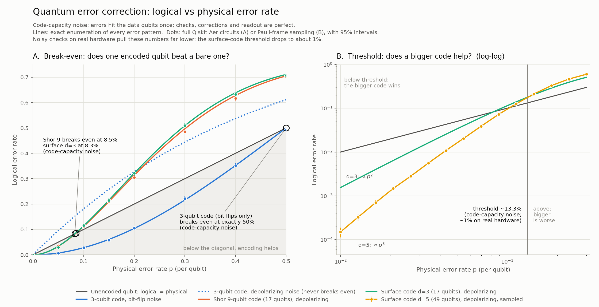
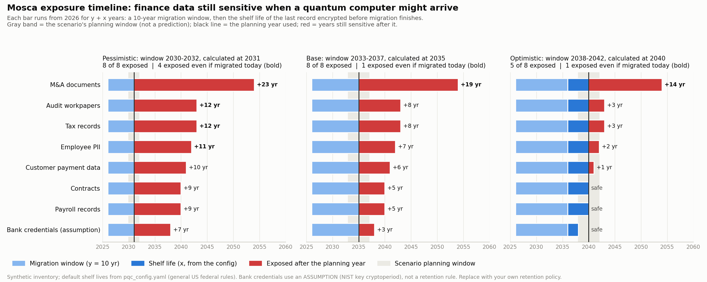

# quantum-finance

Learning quantum computing from zero and pointing it at real finance problems, one small program at a time.

## The story

I am an accountant on the CPA path. In 2026 I started learning quantum computing from scratch, with no physics background, to understand where it might actually matter for finance. This repo is the public record of that climb: it begins with the smallest possible quantum programs (a single coin flip on one qubit) and works up to three finance applications that compare a quantum approach against the classical method a real analyst would use today. Every script is heavily commented in plain language, because the comments are how I teach the concept to myself.

## What's inside

| Folder | What it covers |
|--------|----------------|
| `01_basics/` | Foundational quantum programs: superposition, entanglement, teleportation, and the Bernstein-Vazirani algorithm. The "hello world" layer. |
| `02_algorithms/` | Core quantum algorithms implemented from the gates up: Grover search and quantum error correction. |
| `03_finance/` | Three quantum-vs-classical finance applications, each producing a printed comparison and a chart. |
| `04_security/` | Post-quantum cryptography readiness: why quantum computers could break today's encryption, which finance data may already be at risk, what the code and vendors use, and an assessment-style report on what to migrate. |

### `01_basics/`

- **`coin_flip.py`**: A Hadamard gate on one qubit creates a 50/50 superposition; measuring it many times shows a fair quantum coin.
- **`entangle.py`**: Builds a Bell state (Hadamard plus CNOT) so two qubits become perfectly correlated, the core of entanglement.
- **`teleport.py` / `teleport_clean.py`**: The quantum teleportation protocol, moving a qubit's state across the circuit using entanglement and classical bits.
- **`secret_number.py`**: Bernstein-Vazirani: a quantum circuit recovers a hidden bit string in a single query, no matter how long it is.
- **`compare.py`**: Runs Bernstein-Vazirani classically versus quantumly on a 104-bit secret, showing the classical side needs 104 queries while the quantum side needs one.

### `02_algorithms/`

- **`grover_search.py`**: Grover's search algorithm, which finds a marked item in an unsorted space in roughly the square root of the classical number of steps.
#### Quantum error correction: `02_algorithms/error_correction/`

**What it demonstrates.** How a quantum computer can protect fragile qubits without ever copying them or looking at the information they hold. The project builds error correction up in six stages, from one noisy qubit to the surface code the industry is scaling today. Every encoder, syndrome measurement and decoder is hand-built in Qiskit, and every simulated result is checked against exact math (58 self-checks, printed at the end of each run).

**Start here.** Open [`run_all.py`](02_algorithms/error_correction/run_all.py) first. Its opening comment explains the five ideas the project is about (no-cloning, physical vs logical qubits, syndrome measurement, threshold, overhead) and lists the modules in reading order. Then read the parts in order:

| Part | File | What it shows |
|------|------|---------------|
| 1 | `bare_qubit.py` | An unprotected qubit is wrong with probability p. |
| 2 | `repetition_code.py` | The 3-qubit code finds a bit flip without collapsing the stored state, verified with state fidelity. The conceptual heart of the project. |
| 3 | `phase_flip_code.py` | The bit-flip code is blind to phase errors; its Hadamard-rotated twin catches them. |
| 4 | `shor_code.py` | Shor's 9-qubit code corrects X, Y and Z errors on any qubit, including a continuous rotation. |
| 5 | `surface_code.py` | A distance-3 rotated surface code, with its syndromes drawn on the 2D lattice. |
| 6 | `threshold_sweep.py` | The threshold chart and the physical-qubit overhead arithmetic. |
| shared | `noise_and_tools.py`, `pauli_frame.py` | Settings, noise channels and helpers, plus the exact classical model the circuits are graded against. |

**What the threshold chart shows.** [`error_correction_threshold.png`](02_algorithms/error_correction/error_correction_threshold.png) plots logical error rate against physical error rate p. Panel A asks whether one encoded qubit beats a bare one: a code helps wherever its curve sits below the diagonal, and the crossing is that code's break-even point. Panel B asks whether a *bigger* code helps: below the point where the distance-3 and distance-5 surface-code curves cross, the larger code is more reliable. That crossing is the threshold, and operating below it is what lets error correction scale.



**Read every number with its noise model.** The simulation uses *code-capacity* noise: errors strike the data qubits, but the syndrome measurements that detect them are perfect. Real hardware faces *circuit-level* noise, where the ancilla qubits, gates and measurements doing the checking fail too, and that pulls every number down.

| Result | Code-capacity noise (this simulation) | Circuit-level noise (real hardware) |
|--------|---------------------------------------|-------------------------------------|
| 3-qubit code break-even | 50% (bit-flip noise only) | Lower once the checks can fail; not simulated here |
| Shor 9-qubit / surface d=3 break-even | 8.5% / 8.3% (depolarizing noise) | Lower; not simulated here |
| Surface code threshold | About 13.3% (d=3 vs d=5 crossing) | About 1% (Wang, Fowler & Hollenberg 2011; Fowler et al. 2012) |

The 13.3% figure is a property of the idealized model, not a claim about real devices. The hardware-relevant surface-code threshold is about 1%.

### `03_finance/`

- **`quantum_forecaster.py`**: Forecasts the next three months of revenue two ways: a scikit-learn linear regression versus a one-qubit Variational Quantum Regressor from Qiskit Machine Learning. It demonstrates why an angle-encoded qubit interpolates patterns but cannot extrapolate a straight trend the way linear regression does. Output: `forecast_comparison.png`.
- **`portfolio_optimizer.py`**: Selects an optimal subset of assets by encoding the choice as a QUBO/Ising problem and solving it with a hand-built QAOA circuit, then checks the quantum result against a brute-force classical optimum. It shows how a combinatorial finance decision maps onto a quantum optimizer.
- **`quantum_monte_carlo.py`**: Estimates the probability that a small business runs low on cash during the year, comparing 10,000-path classical Monte Carlo against quantum amplitude estimation (maximum-likelihood, hand-built Grover operator). It makes the quadratic sampling speedup visible: quantum error falls like 1/M versus the classical 1/sqrt(N). Output: `risk_convergence.png`.

### `04_security/`

#### Post-quantum cryptography readiness: `04_security/pqc_readiness/`

**What it demonstrates.** Quantum computers could eventually break the RSA and elliptic-curve encryption that protects financial records in transit, and data recorded today could be decrypted later ("harvest now, decrypt later"). This toolkit is a readiness-assessment framework that turns that threat into controls work. It is demonstrated on a fictional organization with synthetic data only, and it is not an audit or a certification.

| Part | File | What it shows |
|------|------|---------------|
| 1 | `shor_toy.py` | Why RSA breaks: Shor's algorithm factors 15 = 3 x 5 from a quantum-measured period (r = 4 for a = 7), with the classical steps shown and an honest scale check (RSA-2048 would need roughly 1,400 logical qubits, per Gidney 2025). |
| 2 | `mosca.py` | Which data is at risk: Mosca's inequality over 8 finance data types and three quantum-arrival planning windows (2030-2032, 2033-2037, 2038-2042), each built around a cited estimate. These are planning scenarios, not predictions. |
| 3 | `crypto_scanner.py`, `validate_scanner.py` | Where the crypto is: a read-only scanner that classifies findings as quantum-vulnerable, classically weak or PQC-ready, plus a validation mode that reports precision and recall against a CSV of findings marked by hand. |
| 4 | `key_exchange.py` | What to migrate to: X25519 vs ML-KEM-768 (NIST FIPS 203) vs the hybrid X25519MLKEM768 (RFC 10024), measured for key size, ciphertext size and speed. |
| 5 | `audit_report.py`, `report_findings.py`, `report_register.py`, `exposure_chart.py` | The deliverable: a readiness assessment in Condition / Criteria / Cause / Effect / Recommendation format, with a scope statement, the migration-register summary and priority rule, a Limitations section and the exposure chart. |
| 6 | `vendor_review.py` | What the scanner cannot see: a 12-question vendor PQC questionnaire, a vendor tracker template, five fictional vendors, and vendor risk ratings computed by a stated rule. |
| 7 | `migration_register.py`, `asset_register.py`, `priority_rules.py`, `remediation.py` | What to do first: one prioritized row per finding (asset, detected cryptography, location, data classification, exposure, priority, remediation, evidence), in `migration_register.xlsx` and `migration_register.csv`. |
| 8 | `cbom.py` | The same crypto inventory as a CycloneDX 1.7 Cryptography Bill of Materials (`pqc_cbom.cdx.json`), validated against the official 1.7.2 schema. |

**The migration register.** Classification comes only from [`asset_register.yaml`](04_security/pqc_readiness/asset_register.yaml), where people map systems and paths to the data they handle. The tool never infers it: a finding in a file no entry covers is "Unclassified: needs owner review". Exposure comes from the Mosca results for the file's data (the longest shelf life when a file maps to several). Priority comes from a stated first-match rule in `pqc_config.yaml` that anyone can check by hand. Remediation targets cite their standards, with drafts labeled. Every row carries the evidence to reproduce it: file hash, line, matched text, scan time, tool version, and the hashes of the config and the register.

**Start here.** Open [`pqc_readiness_report.md`](04_security/pqc_readiness/pqc_readiness_report.md) for the output, then [`run_all.py`](04_security/pqc_readiness/run_all.py), whose opening comment lists the modules in reading order. Every run prints 92 self-checks, each graded against an independent source (a standard's parameter table, a brute-force calculation, a hand-worked table or a planted answer key). Checks that cannot see their subject report NOT RUN, never PASS.

**Use your own inputs.** Every retention period, the migration time and the scenario windows live in [`pqc_config.yaml`](04_security/pqc_readiness/pqc_config.yaml), with a comment on each field and its default source. The defaults reflect general US federal rules: replace them with your organization's records retention policy before relying on results. Point the run at your own files with `PQC_CONFIG`, `PQC_ASSET_REGISTER`, `PQC_VENDOR_TRACKER` and `PQC_SCAN_ROOT`. Before trusting the scanner on your code, mark the expected findings in a CSV and run `py validate_scanner.py <folder> <expected.csv>`.

**What the chart shows.** [`pqc_readiness_chart.png`](04_security/pqc_readiness/pqc_readiness_chart.png) has one panel per planning scenario. Each bar starts at the assessment year and runs for the migration time plus the data's shelf life. The gray band is the scenario's window, the black line is the planning year used, and red is how many years the data would stay sensitive after it. With the default inputs and a 10-year migration, all 8 data types are exposed in the 2030-2032 and 2033-2037 windows, and 5 of 8 in the 2038-2042 window. M&A documents (18-year shelf life) are exposed in every scenario even if migration finished today. Bank credentials use a labeled assumption (a NIST key cryptoperiod), not a retention rule.



**Limitations.**

* **The code scanner was validated on synthetic samples only.** Its accuracy on real code is unmeasured until someone grades it with the validation mode on files they have marked by hand.
* **It only sees code and configuration files in the target folder.** It does not see live network traffic, compiled binaries, databases, cloud-service settings, hardware security modules, or cryptography chosen at runtime.
* **It cannot detect cryptography inside third-party vendors or SaaS systems.** The vendor questionnaire covers that gap, and its answers are the vendors' own statements until evidenced.
* **A clean scan does not mean an organization is safe.** It means only that no recognized algorithm name appeared in the files given.
* **Classification is only as good as the asset register.** The tool never infers what data a file protects, so a missing or wrong entry gives a missing or wrong exposure.
* **Unclassified findings need owner review** before they can be prioritized by exposure.
* **Priority is a planning aid**, computed by a stated rule, not a risk rating from a certified assessment.
* Factoring 15 demonstrates the mechanism, not the threat level. Retention periods understate how long data must stay secret. NIST IR 8547 and SP 800-131A Rev. 3 are still drafts, and the report labels them as such wherever they are cited.

## How to run

```bash
# 1. Install dependencies (a virtual environment is recommended)
pip install -r requirements.txt

# 2. Run any program directly
python 01_basics/coin_flip.py
python 03_finance/quantum_monte_carlo.py

# 3. Run the whole error-correction walkthrough (about 35 seconds)
python 02_algorithms/error_correction/run_all.py

# 4. Run the PQC readiness toolkit (about 15 seconds; writes the report, chart, questionnaire and run log)
cd 04_security/pqc_readiness && python run_all.py
```

The finance scripts that generate charts write their `.png` next to themselves in `03_finance/`, and `run_all.py` writes `error_correction_threshold.png` next to itself. All of them use a non-interactive matplotlib backend, so they save the file without opening a window.

Note: `quantum_forecaster.py` additionally requires `scikit-learn` and `qiskit-machine-learning` (included in `requirements.txt`). It was developed under an earlier Python/Qiskit environment; the other scripts run on the environment below as-is.

## Environment

| Component | Version |
|-----------|---------|
| Python | 3.14.3 (Windows 11) |
| Qiskit | 2.3.1 |
| Qiskit Aer | 0.17.2 |
| NumPy | 2.4.4 |
| SciPy | 1.17.1 |
| Matplotlib | 3.10.9 |

All quantum circuits run on local simulators (Qiskit Aer and statevector). No quantum hardware or cloud account is required.

`04_security/pqc_readiness/` was built and verified on Python 3.10.11 with Qiskit 2.4.1, Qiskit Aer 0.17.2, NumPy 1.26.4 and cryptography 48.0.0. It needs cryptography 48 or later (the first release whose wheels expose ML-KEM through OpenSSL) and PyYAML for the config file; both were already installed, so nothing new was installed for it.

## About

I'm William Kim, an accountant learning quantum-finance applications in public. The aim is not to claim quantum advantage today; it is to build genuine intuition for how these algorithms work and where they could matter for financial modeling, by writing the code by hand and comparing it honestly against the classical baseline every time.
